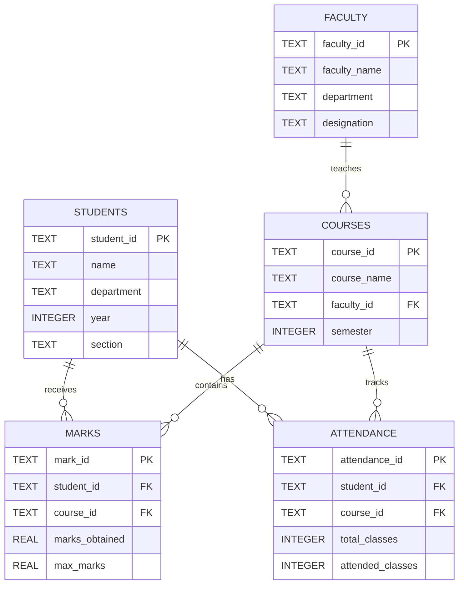

# M1.1 – Education Database ER Diagram

## Entity Relationships

## Relationship Explanation

1. One faculty member can teach multiple courses.
2. One student can have multiple marks records.
3. One course can have multiple marks records.
4. One student can have one attendance summary per course.
5. One course can have attendance records for multiple students.
